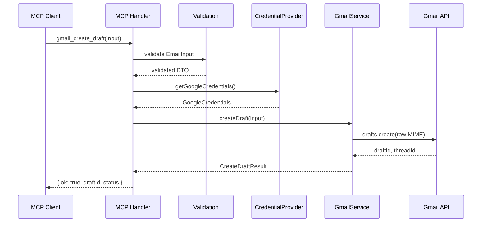
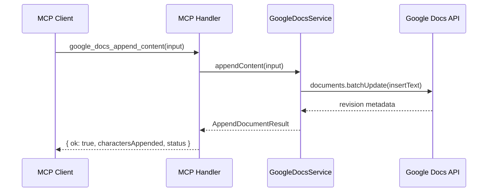

# Architecture: Generic Google Workspace MCP Server

This document describes the technical architecture for a production-ready **Model Context Protocol (MCP) server** that exposes selected Google Workspace capabilities (Gmail and Google Docs) to any MCP-compatible AI agent.

It is derived from [problemStatement.md](./problemStatement.md) and serves as the blueprint for implementation.

---

## 1. Architectural Goals

| Goal | Description |
|------|-------------|
| **Agent-agnostic** | No logic tied to Cursor, a specific LLM, or a particular prompt workflow. MCP is the only public contract. |
| **Modular** | Gmail, Docs, auth, MCP protocol, and configuration are separable and independently testable. |
| **Secure by default** | Least-privilege OAuth scopes, no tokens in tool inputs/outputs, safe logging. |
| **Predictable** | Stable tool names, JSON Schemas, response DTOs, and error codes. |
| **Extensible** | New Google Workspace tools can be added without rewriting core layers. |
| **Deployable** | Environment-driven configuration; transport and token store are pluggable. |

---

## 2. System Context

```text
┌─────────────────────────────────────────────────────────────────┐
│                     MCP-Compatible Clients                       │
│   (Cursor, Claude Desktop, custom agents, remote orchestrators)  │
└────────────────────────────┬────────────────────────────────────┘
                             │ Model Context Protocol
                             │ (stdio / Streamable HTTP)
                             ▼
┌─────────────────────────────────────────────────────────────────┐
│              Generic Google Workspace MCP Server                 │
│  ┌──────────┐  ┌────────────┐  ┌─────────────┐  ┌────────────┐ │
│  │ MCP Layer│→ │ Validation │→ │   Services  │→ │ Integrations│ │
│  └──────────┘  └────────────┘  └─────────────┘  └────────────┘ │
│       │              │                │                │         │
│       │              │         ┌──────┴──────┐         │         │
│       │              │         │ Auth Layer  │         │         │
│       │              │         └─────────────┘         │         │
└───────┼──────────────┼────────────────────────────────┼─────────┘
        │              │                                │
        ▼              ▼                                ▼
   Tool discovery   Structured logs              Gmail API
   & invocation     & request IDs                Google Docs API
```

The MCP server is a **secure integration layer**. Agents never call Google APIs directly and never supply OAuth tokens as tool parameters.

---

## 3. Layered Architecture

Business logic is organized in strict layers. Dependencies flow **downward only** (MCP → services → integrations → Google APIs).

```text
┌─────────────────────────────────────────────────────────────┐
│ Layer 1: MCP Protocol                                        │
│   Server bootstrap, transport, tool registration, handlers   │
└───────────────────────────────┬─────────────────────────────┘
                                │
┌───────────────────────────────▼─────────────────────────────┐
│ Layer 2: Validation & Contracts                              │
│   JSON Schema / Zod, input DTOs, response DTOs, limits       │
└───────────────────────────────┬─────────────────────────────┘
                                │
┌───────────────────────────────▼─────────────────────────────┐
│ Layer 3: Application Services                                │
│   GmailService, GoogleDocsService (domain orchestration)     │
└───────────────────────────────┬─────────────────────────────┘
                                │
        ┌───────────────────────┼───────────────────────┐
        ▼                       ▼                       ▼
┌───────────────┐     ┌─────────────────┐     ┌─────────────────┐
│ Layer 4a:     │     │ Layer 4b:       │     │ Layer 4c:       │
│ Auth          │     │ Gmail           │     │ Google Docs     │
│ Credential    │     │ Integration     │     │ Integration     │
│ Provider      │     │ (MIME, client)  │     │ (batchUpdate)   │
└───────────────┘     └─────────────────┘     └─────────────────┘
        │                       │                       │
        └───────────────────────┴───────────────────────┘
                                ▼
                    Google OAuth 2.0 + REST APIs
```

### Layer responsibilities

| Layer | Responsibility | Must not |
|-------|----------------|----------|
| **MCP** | Protocol wiring, tool metadata, thin handlers | Call Google APIs directly |
| **Validation** | Schema enforcement, payload size limits | Contain OAuth or MIME logic |
| **Services** | Orchestrate auth + integration calls, map results | Know MCP transport details |
| **Auth** | Token load/refresh/store, credential resolution | Expose tokens to MCP clients |
| **Integrations** | Google API clients, request construction | Parse MCP protocol messages |

---

## 4. Recommended Project Structure

Implementation language defaults to **TypeScript on Node.js LTS**, but the layout is language-agnostic.

```text
src/
  index.ts                    # Entry point: load config, start MCP server
  config/
    env.ts                    # Environment parsing & startup validation
    limits.ts                 # MAX_EMAIL_BODY_BYTES, MAX_DOC_APPEND_BYTES
  mcp/
    server.ts                 # MCP server factory & lifecycle
    tools/
      registry.ts             # Tool catalog registration
      gmailCreateDraft.ts     # Handler: validate → service → map response
      gmailSendEmail.ts
      googleDocsAppendContent.ts
  auth/
    credentialProvider.ts     # CredentialProvider interface + default impl
    googleOAuth.ts            # OAuth client, refresh flow
    tokenStore/
      tokenStore.ts           # TokenStore interface
      fileTokenStore.ts       # V1 local dev implementation
  integrations/
    gmail/
      gmailClient.ts          # Gmail API wrapper (drafts.create, messages.send)
      mimeBuilder.ts          # RFC 5322 MIME construction
    googleDocs/
      docsClient.ts           # documents.batchUpdate wrapper
  validation/
    email.ts                  # Recipient & email field validation
    docs.ts                   # documentId, content validation
  errors/
    codes.ts                  # Application error code enum/constants
    mapper.ts                 # Google API errors → AppError
    envelope.ts               # ok/error response builders
  logging/
    logger.ts                 # Structured logger with redaction
    requestContext.ts         # requestId, toolName context

tests/
  unit/                       # Mocked Google clients
  integration/                # Opt-in, real Google test account

docs/
  problemStatement.md
  architecture.md

.env.example
Dockerfile                    # Optional but recommended
```

---

## 5. MCP Tool Design

### 5.1 Tool catalog (V1)

| Tool | Side effect | Purpose |
|------|-------------|---------|
| `gmail_create_draft` | No (creates draft only) | Save email as Gmail draft without sending |
| `gmail_send_email` | **Yes** — sends immediately | Send email via authenticated account |
| `google_docs_append_content` | **Yes** — mutates document | Append text to end of existing Doc |

Tool descriptions must be written for AI agents: concise, explicit, and clear about side effects. Where the MCP SDK supports annotations (e.g., read-only vs destructive hints), `gmail_send_email` and `google_docs_append_content` must be marked as non-read-only.

### 5.2 Handler pattern

Every tool handler follows the same pipeline:

```text
MCP tool invocation
    → parse & validate input (JSON Schema / Zod)
    → resolve credentials (CredentialProvider)
    → call domain service (GmailService / GoogleDocsService)
    → map service result → stable MCP response DTO
    → log structured outcome (no sensitive content)
    → return result or structured error envelope
```

Handlers remain **thin** (~20–40 lines). All Google-specific logic lives in integration modules.

### 5.3 Input schemas

Shared email schema for `gmail_create_draft` and `gmail_send_email`:

```json
{
  "type": "object",
  "properties": {
    "to":  { "type": "array", "items": { "type": "string", "format": "email" }, "minItems": 1 },
    "cc":  { "type": "array", "items": { "type": "string", "format": "email" }, "default": [] },
    "bcc": { "type": "array", "items": { "type": "string", "format": "email" }, "default": [] },
    "subject": { "type": "string" },
    "body":    { "type": "string" },
    "bodyType": { "type": "string", "enum": ["text", "html"], "default": "text" }
  },
  "required": ["to", "subject", "body"],
  "additionalProperties": false
}
```

Google Docs append schema:

```json
{
  "type": "object",
  "properties": {
    "documentId": { "type": "string", "minLength": 1 },
    "content":      { "type": "string", "minLength": 1 },
    "tabId":        { "type": "string", "description": "Optional tab ID; default tab if omitted" },
    "ensureLeadingNewline": { "type": "boolean", "default": false }
  },
  "required": ["documentId", "content"],
  "additionalProperties": false
}
```

### 5.4 Output contracts

**Success envelope** (all tools):

```json
{
  "ok": true,
  "action": "<tool_name>",
  "...toolSpecificFields": "...",
  "status": "<status_code>"
}
```

**Error envelope** (all tools):

```json
{
  "ok": false,
  "action": "<tool_name>",
  "error": {
    "code": "INVALID_INPUT",
    "message": "Human-readable, sanitized message",
    "retryable": false
  }
}
```

Tool-specific success fields:

| Tool | Required response fields |
|------|--------------------------|
| `gmail_create_draft` | `draftId`, `threadId` (if available), `status: "draft_created"` |
| `gmail_send_email` | `messageId`, `threadId` (if available), `status: "sent"` |
| `google_docs_append_content` | `documentId`, `charactersAppended`, `status: "appended"` |

Internal Google client objects must **never** leak into MCP responses.

---

## 6. Domain Services

### 6.1 Interface contracts

```typescript
interface GmailService {
  createDraft(input: EmailInput): Promise<CreateDraftResult>;
  sendEmail(input: EmailInput): Promise<SendEmailResult>;
}

interface GoogleDocsService {
  appendContent(input: AppendDocumentInput): Promise<AppendDocumentResult>;
}

interface CredentialProvider {
  getGoogleCredentials(principal?: string): Promise<GoogleCredentials>;
}
```

### 6.2 Internal data types

```typescript
type EmailInput = {
  to: string[];
  cc?: string[];
  bcc?: string[];
  subject: string;
  body: string;
  bodyType?: "text" | "html";
};

type AppendDocumentInput = {
  documentId: string;
  content: string;
  tabId?: string;
  ensureLeadingNewline?: boolean;
};
```

Services receive validated DTOs, obtain credentials from `CredentialProvider`, delegate to integration clients, and return small result DTOs. They do not know about MCP.

---

## 7. Integration Layer

### 7.1 Gmail integration

**Components:**

- **`mimeBuilder`** — Constructs RFC 5322 MIME messages with To/Cc/Bcc, subject, and plain-text or HTML body. Handles Unicode in headers and body.
- **`gmailClient`** — Wraps `googleapis` Gmail client:
  - `drafts.create` for `gmail_create_draft`
  - `users.messages.send` for `gmail_send_email`
- **Encoding** — Gmail `raw` field requires URL-safe Base64 encoding of the MIME message.

**Flow (send email):**

```text
EmailInput
  → mimeBuilder.build() → MIME string
  → base64url encode
  → gmail.users.messages.send({ userId: "me", requestBody: { raw } })
  → extract messageId, threadId
  → SendEmailResult
```

**Flow (create draft):**

Same MIME construction, but calls `gmail.users.drafts.create` instead. Must never invoke send APIs.

### 7.2 Google Docs integration

**Component:** `docsClient` wraps `documents.batchUpdate`.

**Append strategy:** Use `InsertTextRequest` with `endOfSegmentLocation` so the server appends to the document body without requiring the agent to compute character indexes.

```json
{
  "requests": [{
    "insertText": {
      "text": "<content>",
      "endOfSegmentLocation": { "segmentId": "<tabId or default>" }
    }
  }]
}
```

**Newline policy:**

- Append `content` exactly as provided by default.
- Optional `ensureLeadingNewline: true` prepends `\n` when the caller wants separation from existing content.
- No silent summarization, reformatting, or rich-text conversion in V1.

**Multi-tab docs:** When `tabId` is omitted, append to the first/default tab and document this behavior in README.

---

## 8. Authentication Architecture

### 8.1 Design principles

- OAuth credentials are owned by the **auth layer**, not MCP tool parameters.
- V1 may use a single configured Google account locally, but interfaces must support future multi-user/tenant mapping.
- Token refresh is automatic and transparent to tool handlers.

### 8.2 Component diagram

```text
┌──────────────────┐     ┌──────────────────┐     ┌──────────────────┐
│  Tool Handler    │────▶│ CredentialProvider│────▶│   TokenStore     │
└──────────────────┘     └────────┬─────────┘     └────────┬─────────┘
                                  │                        │
                                  ▼                        ▼
                         ┌──────────────────┐     ┌──────────────────┐
                         │  Google OAuth    │     │ File / Secret    │
                         │  Client (refresh)│     │ Manager / DB     │
                         └──────────────────┘     └──────────────────┘
```

### 8.3 TokenStore abstraction

```typescript
interface TokenStore {
  load(principal?: string): Promise<StoredTokens | null>;
  save(tokens: StoredTokens, principal?: string): Promise<void>;
}

type StoredTokens = {
  accessToken: string;
  refreshToken: string;
  expiryDate: number; // epoch ms
};
```

| Implementation | Use case |
|----------------|----------|
| `FileTokenStore` | Local development (`GOOGLE_TOKEN_STORE_PATH`) |
| Future: secret manager / encrypted DB | Production multi-tenant deployments |

### 8.4 OAuth scopes (least privilege)

| API | Scope | Rationale |
|-----|-------|-----------|
| Gmail (draft + send) | `https://www.googleapis.com/auth/gmail.compose` | Covers both draft creation and sending; narrower than `mail.google.com` |
| Google Docs (edit existing) | `https://www.googleapis.com/auth/documents` | Required when agents may append to arbitrary docs the user can edit |

Evaluate `drive.file` only if the product adopts a per-file authorization model. Document scope choice and user-consent implications in README.

### 8.5 Initial auth flow (local dev)

```text
Developer runs one-time auth script OR server exposes auth helper
    → Browser OAuth consent
    → Authorization code exchanged for tokens
    → Tokens persisted via TokenStore
    → Subsequent MCP tool calls use stored + auto-refreshed tokens
```

Remote deployments must map **MCP caller identity** ↔ **Google account** explicitly (future concern; interfaces prepared in V1).

---

## 9. Error Handling

### 9.1 Single error envelope

All failures return the structured `{ ok: false, action, error }` shape. Production must not return raw stack traces.

### 9.2 Error code taxonomy

| Code | Typical cause | Retryable | Agent action |
|------|---------------|-----------|--------------|
| `INVALID_INPUT` | Bad email, empty doc ID | No | Fix input |
| `AUTH_NOT_CONFIGURED` | Missing env / token store | No | Admin setup |
| `GOOGLE_AUTH_REQUIRED` | No valid tokens | No | User re-authenticate |
| `GOOGLE_TOKEN_REFRESH_FAILED` | Refresh token revoked | No | User re-authenticate |
| `INSUFFICIENT_SCOPE` | Missing OAuth scope | No | Re-consent with correct scopes |
| `GMAIL_DRAFT_CREATE_FAILED` | Gmail API error | Maybe | Check error message |
| `GMAIL_SEND_FAILED` | Gmail API error | Caution | See idempotency rules |
| `DOC_NOT_FOUND` | Invalid document ID | No | Use valid doc |
| `DOC_PERMISSION_DENIED` | No edit access | No | User grants access |
| `DOC_APPEND_FAILED` | Docs API error | Caution | See idempotency rules |
| `GOOGLE_RATE_LIMITED` | 429 from Google | Yes | Backoff and retry |
| `GOOGLE_API_UNAVAILABLE` | 5xx from Google | Yes | Backoff and retry |
| `PAYLOAD_TOO_LARGE` | Body/content exceeds limit | No | Reduce payload |
| `INTERNAL_ERROR` | Unexpected server fault | No | Report / investigate |

### 9.3 Google error mapping

`errors/mapper.ts` translates `googleapis` HTTP status and error payloads into application codes. Sanitize messages before returning to MCP clients (strip internal URLs, token fragments, raw Google error blobs).

---

## 10. Idempotency and Retry Policy

Side-effecting operations require conservative retry behavior.

| Operation | Duplicate risk on retry | Policy |
|-----------|-------------------------|--------|
| `gmail_create_draft` | Duplicate drafts | Retry only on clearly pre-request failures (validation, auth). No blind retry after ambiguous network timeout. |
| `gmail_send_email` | **Duplicate emails** | Never auto-retry after request may have reached Google. Exponential backoff only for explicit rate limits (429) or pre-send failures. |
| `google_docs_append_content` | Duplicate appended text | Same as send — no blind replay after ambiguous outcome. |

Optional future enhancement: caller-supplied `idempotencyKey` with persisted request/result mapping.

---

## 11. Security Architecture

```text
┌─────────────────────────────────────────────────────────────┐
│ Security boundaries                                          │
├─────────────────────────────────────────────────────────────┤
│ MCP Client  │  No OAuth tokens in tool inputs or outputs    │
│ Validation  │  Email format, payload size limits            │
│ Logging     │  Redact tokens, bodies, doc content, Bcc      │
│ Secrets     │  env vars / secret manager; .env gitignored   │
│ Transport   │  HTTPS for remote deployments                 │
│ Scopes      │  Least privilege OAuth scopes                 │
└─────────────────────────────────────────────────────────────┘
```

**Logging redaction rules:**

| Never log | Acceptable alternatives |
|-----------|-------------------------|
| accessToken, refreshToken, clientSecret | `[REDACTED]` |
| Full email body | `bodyLength: N` |
| Full doc append content | `charactersAppended: N` |
| Bcc recipients | Omit or count only |
| To/Cc addresses (optional) | `recipientCount: N` or masked |

**Human-in-the-loop:** Document that MCP hosts should confirm high-impact sends when appropriate. The server executes validated inputs; it does not invent recipients or content.

---

## 12. Configuration

Environment-based configuration validated at startup. Missing required values fail fast with clear messages.

```dotenv
# Google OAuth
GOOGLE_CLIENT_ID=
GOOGLE_CLIENT_SECRET=
GOOGLE_REDIRECT_URI=
GOOGLE_TOKEN_STORE_PATH=

# MCP transport
MCP_TRANSPORT=stdio          # stdio | streamable-http
MCP_HOST=127.0.0.1             # HTTP mode only
MCP_PORT=3000                  # HTTP mode only

# Observability & limits
LOG_LEVEL=info
MAX_EMAIL_BODY_BYTES=1048576
MAX_DOC_APPEND_BYTES=1048576
```

Configuration module loads, validates, and exposes a typed `Config` object. No scattered `process.env` reads outside `config/`.

---

## 13. MCP Transport

Transport is a **plumbing concern** isolated from business logic.

| Mode | Primary use | Notes |
|------|-------------|-------|
| **stdio** | Local IDE clients (Cursor, Claude Desktop) | Default for development |
| **Streamable HTTP** | Remote / containerized deployments | Enable via `MCP_TRANSPORT` without rewriting services |

```text
┌─────────────┐     ┌─────────────┐     ┌─────────────────────────┐
│  stdio      │     │  HTTP       │     │  Shared core             │
│  transport  │────▶│  transport  │────▶│  tools + services + auth │
└─────────────┘     └─────────────┘     └─────────────────────────┘
```

Follow the **current official MCP SDK** transport APIs rather than legacy session patterns.

---

## 14. Logging and Observability

Structured JSON logs with request-scoped context.

**Standard fields:**

```text
timestamp, level, requestId, toolName, principal,
googleApi, durationMs, resultStatus, errorCode
```

**Example success log:**

```json
{
  "level": "info",
  "requestId": "req_abc123",
  "toolName": "gmail_send_email",
  "recipientCount": 2,
  "durationMs": 481,
  "resultStatus": "success"
}
```

Each tool invocation generates a unique `requestId` (UUID) at handler entry and propagates it through services and integration calls.

---

## 15. End-to-End Request Flows

### 15.1 Create Gmail draft



### 15.2 Send email

Same flow as draft, but `GmailService.sendEmail` calls `messages.send`. Tool metadata marks this as a side-effecting operation.

### 15.3 Append to Google Doc



---

## 16. Testing Architecture

### 16.1 Unit tests (default CI)

Mock Google API clients at the integration boundary.

| Area | Test focus |
|------|------------|
| Validation | Email format, empty recipients, payload limits |
| MIME builder | Headers, Cc/Bcc, text vs HTML, Unicode |
| Base64URL | Gmail raw encoding correctness |
| Docs client | `batchUpdate` request construction, tabId handling |
| Error mapper | Google status codes → app error codes |
| Config | Startup validation, missing env detection |
| Logging | Redaction of tokens and sensitive content |

### 16.2 Integration tests (opt-in)

Gated by environment flag (e.g., `RUN_INTEGRATION_TESTS=1`) against a dedicated Google test account.

| Scenario | Verification |
|----------|--------------|
| Draft creation | Draft exists, message not sent |
| Send email | Message delivered to test mailbox |
| Docs append | Content appended, existing text unchanged |
| Auth failures | Insufficient scope → `INSUFFICIENT_SCOPE` |
| Permission denied | `DOC_PERMISSION_DENIED` mapping |

Real email sends must **never** run in the default unit-test command.

---

## 17. Deployment

### 17.1 Local development

```text
1. Clone repo
2. Copy .env.example → .env
3. Configure Google Cloud project + OAuth credentials
4. Run one-time OAuth flow → tokens stored locally
5. npm run dev  (stdio transport)
6. Connect MCP client via example config
```

### 17.2 Docker (recommended)

```text
Dockerfile
  → multi-stage build (TypeScript compile)
  → minimal runtime image
  → env vars injected at run time
  → token store mounted as volume OR replaced with secret manager
```

### 17.3 Production considerations

- Replace `FileTokenStore` with platform-appropriate secret storage.
- Enable HTTPS for HTTP transport.
- Set conservative payload limits.
- Run security review before exposing send-email capability broadly.

---

## 18. Extension Points (Post-V1)

The architecture supports adding tools without breaking existing contracts:

| Extension | Approach |
|-----------|----------|
| New Gmail tools (read, search) | New handler + `GmailService` method + scope review |
| Google Sheets / Calendar | New `integrations/` module + new service interface |
| Multi-user auth | Implement `CredentialProvider` with principal from MCP session context |
| Idempotency keys | Middleware before service call + persistent key store |
| Attachments | Extend `mimeBuilder` + email input schema (V2) |

Out-of-scope V1 features (inbox read, doc creation, rich formatting, etc.) are listed in [problemStatement.md §4](./problemStatement.md).

---

## 19. Technology Stack (Recommended)

| Concern | Choice |
|---------|--------|
| Runtime | Node.js (current LTS) |
| Language | TypeScript |
| MCP | Official/maintained MCP TypeScript SDK |
| Google APIs | `googleapis` npm package |
| Validation | Zod (or equivalent) |
| Testing | Vitest or Jest |
| Logging | Structured logger (pino, winston, or equivalent) |

Do not hand-roll OAuth, MIME, or HTTP when maintained libraries exist.

---

## 20. Implementation Sequence

Build in dependency order to keep each layer testable early:

1. Project skeleton, config validation, error envelope
2. MCP server with stub tools (echo responses)
3. Auth: `TokenStore`, `CredentialProvider`, OAuth refresh
4. Gmail: MIME builder → draft → send
5. Google Docs: append via `batchUpdate`
6. Error mapping from Google APIs
7. Structured logging with redaction
8. Unit tests
9. Integration test harness (opt-in)
10. Example MCP client configuration
11. Docker packaging
12. README and security review

---

## 21. Acceptance Mapping

Architecture satisfies [problemStatement.md §20](./problemStatement.md) when:

- All three MCP tools are discoverable and functional against real Google APIs.
- OAuth refresh works without agent involvement.
- Responses and errors follow the defined envelopes.
- Logs exclude secrets and user-generated content.
- Ambiguous retries do not duplicate sends or appends.
- Unit tests pass; integration instructions exist.
- Server runs unchanged across MCP clients (connection config only).

---

## 22. Key Design Decisions Summary

| Decision | Rationale |
|----------|-----------|
| MCP is the public contract | Agents interact with tool schemas, not Google APIs |
| Thin handlers, fat services | Keeps protocol layer stable and testable |
| `CredentialProvider` abstraction | Enables single-account V1 and multi-tenant future |
| `gmail.compose` scope | Single scope covers draft + send |
| `endOfSegmentLocation` for Docs | Agents need not compute document indexes |
| Separate draft and send tools | No ambiguous side-effect behavior |
| Conservative retry on sends | Prevents duplicate email delivery |
| Pluggable `TokenStore` | File store for dev, secret manager for prod |

---

## 23. References

- [Model Context Protocol specification](https://modelcontextprotocol.io/specification/)
- [MCP server tools](https://modelcontextprotocol.io/specification/draft/server/tools)
- [Gmail API — sending](https://developers.google.com/workspace/gmail/api/guides/sending)
- [Gmail API — drafts.create](https://developers.google.com/workspace/gmail/api/reference/rest/v1/users.drafts/create)
- [Google OAuth scopes](https://developers.google.com/identity/protocols/oauth2/scopes)
- [Google Docs API auth](https://developers.google.com/workspace/docs/api/auth)
- [Google Docs batchUpdate](https://developers.google.com/workspace/docs/api/concepts/request-response)
